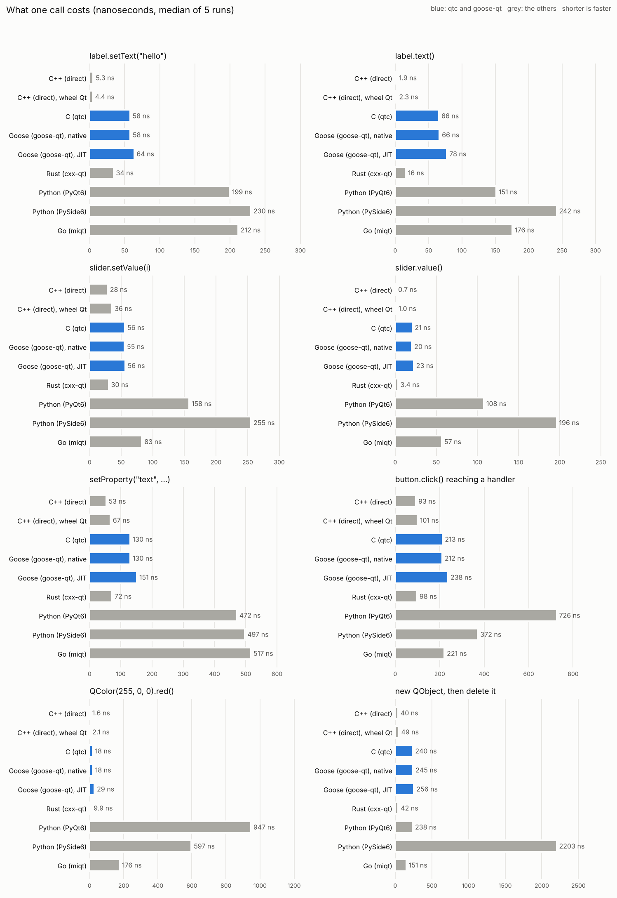

# How goose-qt compares

The same benchmark was written eight ways and run on one machine: C++ calling Qt directly,
qtc from C, goose-qt (native and JIT), PyQt6, PySide6, Go's
[miqt](https://github.com/mappu/miqt) and Rust's [cxx-qt](https://github.com/KDAB/cxx-qt).
All use Qt 6.12. The benchmark's source, and how to rerun it, are in
[bench/compare](../bench/compare); the raw numbers are in
[results.md](../bench/compare/results/results.md).

**In short:**
- **Per call, goose-qt is 2–5× faster than PyQt6** and 1.8–10× faster than PySide6, and
  ahead of Go's miqt on every call but object creation: level on signals, up to 4× on
  properties. A plain call costs 20–66 ns, where C++ pays 1–28 ns.
- **Small values are structs now.** `qt::color(255, 0, 0).red()` takes 18 ns: 51× faster
  than PyQt6, 9.6× faster than Go, within 2× of Rust. Points, sizes, rectangles, lines,
  margins and colors no longer need a handle (goose-qt 1.6.0, qtc 1.3.0).
- **Rust's cxx-qt is the closest to C++.** It calls Qt through `cxx` bridges with nothing in
  between: 1–8× a direct C++ call, and a fraction of goose-qt's cost. It checks nothing at
  run time. Its misuse probes need `unsafe`, and all three crashed or silently truncated.
- **Where Qt calls back into your code** (a model written in the language), goose-qt is
  2.2× faster than Go and 3.9× faster than PyQt6, within 2.5× of C++.
- **Startup and memory are near C++.** Startup takes 26 ms, against 20 ms for C++, 21–22 ms
  for Rust and Go and 76 ms for PyQt6. Peak memory is 39 MiB, against 30 MiB for C++ and
  Rust, 44 MiB for Go and 49 MiB for PyQt6.
- **Making and destroying a `QObject` is level with PyQt6 and behind Go:** 245 ns against
  238 and 151. That is a handle, its ownership tracking and the checks that turn "use after
  delete" into an error.
- **It is the only one where all three misuse probes come back as errors.** The others
  crash, hang or silently do the wrong thing on at least one.

Machine: two cores of a Xeon VM (2.3 GHz nominal; slower than the one of the 1.5.0 run, so
compare numbers within a table), 7 GB, Linux. Medians of five runs, each in its own
process; startup over 15 runs. Qt 6.12.0 everywhere: conda-forge's build for the compiled
programs, and Qt's own build inside the Python wheels. The C++ program ran on both, and the
two Qt builds are within a few percent of each other except for painting.

## Calls

| ns per call | C++ | Rust (cxx-qt) | qtc (C) | **goose-qt** | PyQt6 | PySide6 | Go (miqt) |
|---|---:|---:|---:|---:|---:|---:|---:|
| `label.setText("hello")` | 5.3 | 34 | 58 | **58** | 199 | 230 | 212 |
| `label.text()` | 1.9 | 16 | 66 | **66** | 151 | 242 | 176 |
| `slider.setValue(i)` | 28 | 30 | 56 | **55** | 158 | 255 | 83 |
| `slider.value()` | 0.7 | 3.4 | 21 | **20** | 108 | 196 | 57 |
| `setProperty("text", …)` | 53 | 72 | 130 | **130** | 472 | 497 | 517 |
| `button.click()` reaching a handler | 93 | 98 | 213 | **212** | 726 | 372 | 221 |
| `QColor(255, 0, 0).red()` | 1.6 | 9.9 | 18 | **18** | 947 | 597 | 176 |
| a `QObject` made and deleted | 40 | 42 | 240 | **245** | 238 | 2,203 | 151 |

goose-qt is the native build; the JIT adds 2–17% (more on the 18 ns color row). C++ is the floor: a binding cannot beat a
direct call.

Notes on the rows:
- **Calls.** goose-qt calls qtc's direct entry points: one C function per bound signature
  (`qtcm_setText__QString`), resolved once per class and then a jump to the thunk, with
  every check still made. Goose's typed wrappers compile to a direct call to them.
- **Rust.** cxx-qt declares each Qt method in a `cxx` bridge and calls it through a C++
  shim: nothing is looked up or checked at run time, so it pays only for the shim and string
  conversion. It is the fastest binding on every call row.
- **Signals.** C++, Python, Go and Rust run a function inside the emission. goose-qt queues
  the emission and the program polls it, which lets a handler destroy the sender safely.
  Even so, the round trip costs less than either Python binding or Go.
- **Value types.** goose-qt makes the color as a `qt::Color` struct with `QColor`'s own
  layout (`values.goose`, qtc's `qtc_inline.h`): no handle, a direct call into Qt, and still
  a check that the struct holds a valid color. Go keeps a raw pointer to a heap `QColor`,
  Rust a C++ value on its stack. Values without a struct form (`QFont`, `QImage`, ...) are
  handles in qtc's registry, as before.
- **Objects made and destroyed.** Every object gets a handle and its ownership is tracked:
  which objects hold it, whether Qt owns it, whether it is the internal part of another.
  That bookkeeping turns "use after delete" into an error instead of a crash (see below).
  qtc 1.2.0 cut it from 1.6 µs to 0.2 µs by making objects as a subclass whose destructor
  releases the handle (sip's technique) and by deleting at once.

## Whole tasks

| | C++ | Rust (cxx-qt) | qtc (C) | **goose-qt** | PyQt6 | PySide6 | Go (miqt) |
|---|---:|---:|---:|---:|---:|---:|---:|
| filter 1,000,000 rows of a model written in the language | 229 ms | 250 ms | 609 ms | **564 ms** | 2,201 ms | 2,656 ms | 1,213 ms |
| paint 100,000 lines into an image | 26 ms | 29 ms | 37 ms | **36 ms** | 64 ms | 53 ms | 33 ms |
| 2,000 buttons: create, show, paint, destroy | 57 ms | 57 ms | 51 ms | **51 ms** | 76 ms | 131 ms | 61 ms |
| startup to exit (a label shown and painted) | 20 ms | 21 ms | 25 ms | **26 ms** | 76 ms | 148 ms | 22 ms |
| peak memory of that program | 30 MiB | 31 MiB | 39 MiB | **39 MiB** | 49 MiB | 57 MiB | 44 MiB |

The model filter calls into the language once per row: Qt asks the model for each row's
text. goose-qt answers a million of those calls in 564 ms. That is 2.2× faster than Go,
3.9× faster than PyQt6 and 4.7× faster than PySide6. A model in C++ or Rust, which Qt calls
as a virtual function, takes 0.2 s.

Startup and memory used to be the cost of loading all of qtc at once: 25 Qt modules and the
tables of 13,600 methods. Since qtc 1.2.0, `libqtc` holds Qt Core, Gui and Widgets, and each
other module is a library of its own, loaded when the program first uses one of its classes.
A widgets program maps 4 Qt libraries instead of about 30. The JIT still compiles
`api.goose` at start, which takes over half a second (645 ms, 241 MiB here): nearly all of it
is the Goose compiler checking every function of `api.goose`, also those the program never
calls. Native builds do that ahead of time.

## Misuse

Three mistakes, each made once in each binding ([bench/compare/misuse](../bench/compare/misuse); output in
[misuse.txt](../bench/compare/results/misuse.txt)):

| | a child used after its parent was deleted | an `int` argument of 10,000,000,000 | a call Qt itself crashes on: `combo.setView(combo.view())` |
|---|---|---|---|
| C++ | segfault | silently truncated | segfault |
| **goose-qt** | **error: `QTC_ERR_STALE_HANDLE`** | **error: `QTC_ERR_OUT_OF_RANGE`** | **error: `QTC_ERR_STATE`, refused** |
| PyQt6 | exception (`RuntimeError`) | exception (`OverflowError`) | segfault |
| PySide6 | exception (`RuntimeError`) | exception (`OverflowError`) | segfault (in another run, a hang) |
| Go (miqt) | segfault (`SIGSEGV` in cgo) | silently truncated | segfault |
| Rust (cxx-qt) | segfault (in an `unsafe` block) | silently truncated (an `as i32` cast) | segfault (in an `unsafe` block) |

The Python bindings track deleted wrappers and check integer ranges. Rust makes the program
spell out the dangerous parts: a raw pointer to an object Qt owns can only be used in
`unsafe`, and the 64-bit value has to be cast. None of them protects against inputs that
crash Qt itself. qtc refuses nearly 400 such inputs, each found by fuzzing, see
[Stability](stability.md). Those checks are part of the per-call cost above: the call path
still does all of them.

## What changed to get here

The first run of this comparison, with qtc 1.1.0, had goose-qt behind PyQt6 on every call.
qtc 1.1.1 cached what could be cached. qtc 1.2.0 added three things, without dropping a
check ([changelog](../../qtc/CHANGELOG.md)): a C function per bound signature, called
directly by goose-qt's wrappers; objects made as a subclass that tells qtc when it dies;
and a library per Qt module, loaded on first use. qtc 1.3.0 added small values as structs
and made the handle registry cheaper.

The machine changed between runs, so this table gives each goose-qt number as a multiple
of PyQt6's speed in the same run:

| goose-qt, native, × PyQt6's speed | 1.4.0 (qtc 1.1.1) | 1.5.0 (qtc 1.2.0) | 1.6.0 (qtc 1.3.0) |
|---|---:|---:|---:|
| `label.setText("hello")` | 1.1× | 3.2× | 3.4× |
| `label.text()` | 1.0× | 2.1× | 2.3× |
| `slider.setValue(i)` | 1.1× | 3.1× | 2.9× |
| `slider.value()` | 1.2× | 5.5× | 5.3× |
| `setProperty("text", …)` | 1.8× | 3.6× | 3.6× |
| signal round trip | 2.2× | 3.3× | 3.4× |
| `QColor(255, 0, 0).red()` | 2.2× | 5.7× | 51× |
| a `QObject` made and deleted | 0.16× | 0.94× | 0.97× |
| million-row model filter | 3.7× | 3.7× | 3.9× |
| startup | 1.4× | 3.0× | 2.9× |
| peak memory (PyQt6's ÷ goose-qt's) | 0.74× | 1.25× | 1.25× |

qtc 1.3.0 passes its 19 test suites in release and AddressSanitizer + UndefinedBehaviorSanitizer
builds. The sanitizer run found a crash 1.2.0 had made reachable (a CoAP client deleted right
after a request crashed Qt's protocol thread), fixed in 1.3.0; see qtc's changelog. The
method fuzzer ran on the new code under the sanitizers: the fixed order, by name, object
lifetimes and three random orders, clean but for one call that is slow rather than wrong
(`QString::toUcs4` on a string earlier calls had grown large).

## Caveats

- One machine and one Qt version. The ratios carry over better than the absolute numbers.
- Each row measures one operation in a tight loop. Real programs spend most of their time
  in Qt (layout, painting, text), where every binding costs the same.
- PyQt6 and PySide6 run on Qt's official build. The other programs run on conda-forge's
  build. The C++ row on both builds shows the difference: noise, except painting, where the
  official build is faster.
- miqt is version 0.15.0. Building its Qt 6 package took 21 minutes and more than 7 GB of
  memory (it was built with swap and the Go compiler's parallelism off).
- cxx-qt is version 0.10 with cxx-qt-lib's `qt_gui` feature. Widgets have no bindings in
  cxx-qt-lib, so the Rust program declares the `QWidget` classes it uses in its own `cxx`
  bridge (with a few lines of C++ for constructors), as a cxx-qt widgets program would.
