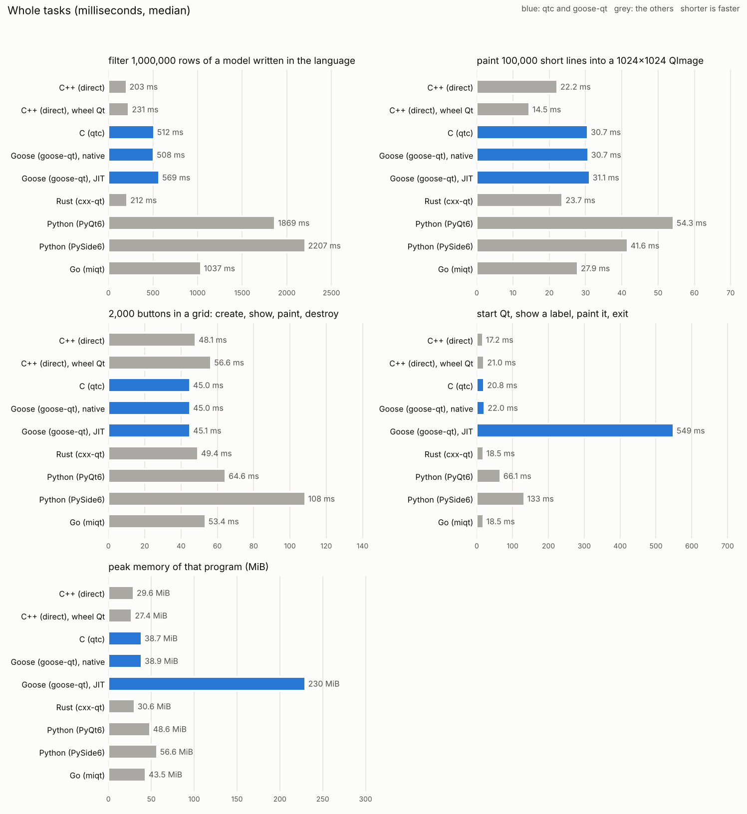

# How goose-qt compares

The same benchmark was written eight ways and run on one machine: C++ calling Qt directly,
qtc from C, goose-qt (native and JIT), PyQt6, PySide6, Go's
[miqt](https://github.com/mappu/miqt) and Rust's [cxx-qt](https://github.com/KDAB/cxx-qt).
All use Qt 6.12. The benchmark's source, and how to rerun it, are in
[bench/compare](../bench/compare); the raw numbers are in
[results.md](../bench/compare/results/results.md).

**In short:**
- **Per call, goose-qt is 2–6× faster than PyQt6** and 2–10× faster than PySide6. It is
  also ahead of Go's miqt on every call but object creation: level on signals and `QColor`,
  up to 4× on properties. A plain call costs 17–57 ns, where C++ pays 1–24 ns.
- **Rust's cxx-qt is the closest to C++.** It calls Qt through `cxx` bridges with nothing in
  between: 1–7× a direct C++ call, and a fraction of goose-qt's cost. It checks nothing at
  run time. Its misuse probes need `unsafe`, and all three crashed or silently truncated.
- **Where Qt calls back into your code** (a model written in the language), goose-qt is
  2.0× faster than Go and 3.7× faster than PyQt6, within 2.5× of C++.
- **Startup and memory are now near C++.** Startup takes 22 ms, against 17 ms for C++, 19 ms
  for Go and Rust and 66 ms for PyQt6. Peak memory is 39 MiB, against 30 MiB for C++ and
  Rust, 44 MiB for Go and 49 MiB for PyQt6.
- **Making and destroying a `QObject` is the one row where it is behind PyQt6 and Go:** 208
  ns against 196 and 128. That is a handle, its ownership tracking and the checks
  that turn "use after delete" into an error.
- **It is the only one where all three misuse probes come back as errors.** The others
  crash, hang or silently do the wrong thing on at least one.

Machine: two cores of a 2.3 GHz Xeon, 7 GB, Linux. Medians of five runs, each in its own
process; startup over 15 runs. Qt 6.12.0 everywhere: conda-forge's build for the compiled
programs, and Qt's own build inside the Python wheels. The C++ program ran on both, and the
two Qt builds are within a few percent of each other except for painting.

## Calls

| ns per call | C++ | Rust (cxx-qt) | qtc (C) | **goose-qt** | PyQt6 | PySide6 | Go (miqt) |
|---|---:|---:|---:|---:|---:|---:|---:|
| `label.setText("hello")` | 4.4 | 29 | 49 | **51** | 160 | 195 | 175 |
| `label.text()` | 1.8 | 13 | 54 | **57** | 122 | 208 | 146 |
| `slider.setValue(i)` | 24 | 26 | 43 | **42** | 133 | 205 | 70 |
| `slider.value()` | 0.6 | 2.9 | 18 | **17** | 93 | 168 | 48 |
| `setProperty("text", …)` | 45 | 60 | 106 | **109** | 397 | 415 | 434 |
| `button.click()` reaching a handler | 80 | 83 | 173 | **180** | 598 | 307 | 186 |
| `QColor(255, 0, 0).red()` | 1.4 | 8.3 | 139 | **140** | 802 | 483 | 148 |
| a `QObject` made and deleted | 35 | 36 | 205 | **208** | 196 | 1,829 | 128 |

goose-qt is the native build; the JIT adds 2–19%. C++ is the floor: a binding cannot beat a
direct call.

Notes on the rows:
- **Calls.** goose-qt calls qtc's direct entry points: one C function per bound signature
  (`qtcm_setText__QString`), resolved once per class and then a jump to the thunk, with
  every check still made. Goose's typed wrappers compile to a direct call to them.
- **Rust.** cxx-qt declares each Qt method in a `cxx` bridge and calls it through a C++
  shim: nothing is looked up or checked at run time, so it pays only for the shim and string
  conversion. It is the fastest binding on every call row.
- **Signals.** C++, Python, Go and Rust run a function inside the emission. goose-qt queues
  the emission and the program polls it, which lets a handler destroy the sender safely.
  Even so, the round trip costs less than either Python binding or Go.
- **Value types.** Each goose-qt value is a handle in qtc's registry, checked on every use.
  Go keeps a raw pointer and Rust a C++ value on its stack, which is faster and unchecked.
- **Objects made and destroyed.** Every object gets a handle and its ownership is tracked:
  which objects hold it, whether Qt owns it, whether it is the internal part of another.
  That bookkeeping turns "use after delete" into an error instead of a crash (see below).
  qtc 1.2.0 cut it from 1.6 µs to 0.2 µs by making objects as a subclass whose destructor
  releases the handle (sip's technique) and by deleting at once.

## Whole tasks

| | C++ | Rust (cxx-qt) | qtc (C) | **goose-qt** | PyQt6 | PySide6 | Go (miqt) |
|---|---:|---:|---:|---:|---:|---:|---:|
| filter 1,000,000 rows of a model written in the language | 203 ms | 212 ms | 512 ms | **508 ms** | 1,869 ms | 2,207 ms | 1,037 ms |
| paint 100,000 lines into an image | 22 ms | 24 ms | 31 ms | **31 ms** | 54 ms | 42 ms | 28 ms |
| 2,000 buttons: create, show, paint, destroy | 48 ms | 49 ms | 45 ms | **45 ms** | 65 ms | 108 ms | 53 ms |
| startup to exit (a label shown and painted) | 17 ms | 19 ms | 21 ms | **22 ms** | 66 ms | 133 ms | 19 ms |
| peak memory of that program | 30 MiB | 31 MiB | 39 MiB | **39 MiB** | 49 MiB | 57 MiB | 44 MiB |

The model filter calls into the language once per row: Qt asks the model for each row's
text. goose-qt answers a million of those calls in 508 ms. That is 2.0× faster than Go,
3.7× faster than PyQt6 and 4.3× faster than PySide6. A model in C++ or Rust, which Qt calls
as a virtual function, takes 0.2 s.

Startup and memory used to be the cost of loading all of qtc at once: 25 Qt modules and the
tables of 13,600 methods. Since qtc 1.2.0, `libqtc` holds Qt Core, Gui and Widgets, and each
other module is a library of its own, loaded when the program first uses one of its classes.
A widgets program maps 4 Qt libraries instead of about 30. The JIT still compiles
`api.goose`'s functions at start, which takes about half a second (549 ms, 230 MiB); native
builds do that ahead of time.

## Misuse

Three mistakes, each made once in each binding ([bench/compare/misuse](../bench/compare/misuse); output in
[misuse.txt](../bench/compare/results/misuse.txt)):

| | a child used after its parent was deleted | an `int` argument of 10,000,000,000 | a call Qt itself crashes on: `combo.setView(combo.view())` |
|---|---|---|---|
| C++ | segfault | silently truncated | segfault |
| **goose-qt** | **error: `QTC_ERR_STALE_HANDLE`** | **error: `QTC_ERR_OUT_OF_RANGE`** | **error: `QTC_ERR_STATE`, refused** |
| PyQt6 | exception (`RuntimeError`) | exception (`OverflowError`) | segfault |
| PySide6 | exception (`RuntimeError`) | exception (`OverflowError`) | segfault (in another run, a hang) |
| Go (miqt) | segfault (`SIGSEGV` in cgo) | silently truncated | segfault |
| Rust (cxx-qt) | segfault (in an `unsafe` block) | silently truncated (an `as i32` cast) | segfault (in an `unsafe` block) |

The Python bindings track deleted wrappers and check integer ranges. Rust makes the program
spell out the dangerous parts: a raw pointer to an object Qt owns can only be used in
`unsafe`, and the 64-bit value has to be cast. None of them protects against inputs that
crash Qt itself. qtc refuses nearly 400 such inputs, each found by fuzzing, see
[Stability](stability.md). Those checks are part of the per-call cost above: the call path
still does all of them.

## What changed to get here

The first run of this comparison, with qtc 1.1.0, had goose-qt behind PyQt6 on every call.
qtc 1.1.1 cached what could be cached. qtc 1.2.0 added three things, without dropping a
check ([changelog](../../qtc/CHANGELOG.md)): a C function per bound signature, called
directly by goose-qt's wrappers; objects made as a subclass that tells qtc when it dies;
and a library per Qt module, loaded on first use.

The machine changed between runs (C++ got about 15% faster), so this table puts each
goose-qt number next to PyQt6's from the same run:

| goose-qt, native | 1.4.0 (qtc 1.1.1) | | 1.5.0 (qtc 1.2.0) | |
|---|---:|---:|---:|---:|
| `label.setText("hello")` | 157 ns | 1.1× PyQt6's speed | 51 ns | 3.2× |
| `label.text()` | 151 ns | 1.0× | 57 ns | 2.1× |
| `slider.setValue(i)` | 158 ns | 1.1× | 42 ns | 3.1× |
| `slider.value()` | 100 ns | 1.2× | 17 ns | 5.5× |
| `setProperty("text", …)` | 297 ns | 1.8× | 109 ns | 3.6× |
| signal round trip | 374 ns | 2.2× | 180 ns | 3.3× |
| `QColor(255, 0, 0).red()` | 443 ns | 2.2× | 140 ns | 5.7× |
| a `QObject` made and deleted | 1,577 ns | 0.16× | 208 ns | 0.94× |
| million-row model filter | 683 ms | 3.7× | 508 ms | 3.7× |
| startup | 51 ms | 1.4× | 22 ms | 3.0× |
| peak memory | 65 MiB | 0.74× (more) | 39 MiB | 1.25× (less) |

qtc 1.2.0 passes its 19 test suites in release and AddressSanitizer + UndefinedBehaviorSanitizer
builds, and the method fuzzer ran clean on the new code under the sanitizers: the fixed order,
by name, object lifetimes and three random orders.

## Caveats

- One machine and one Qt version. The ratios carry over better than the absolute numbers.
- Each row measures one operation in a tight loop. Real programs spend most of their time
  in Qt (layout, painting, text), where every binding costs the same.
- PyQt6 and PySide6 run on Qt's official build. The other programs run on conda-forge's
  build. The C++ row on both builds shows the difference: noise, except painting, where the
  official build is faster.
- miqt is version 0.15.0. Building its Qt 6 package took 21 minutes and more than 7 GB of
  memory (it was built with swap and the Go compiler's parallelism off).
- cxx-qt is version 0.10 with cxx-qt-lib's `qt_gui` feature. Widgets have no bindings in
  cxx-qt-lib, so the Rust program declares the `QWidget` classes it uses in its own `cxx`
  bridge (with a few lines of C++ for constructors), as a cxx-qt widgets program would.
