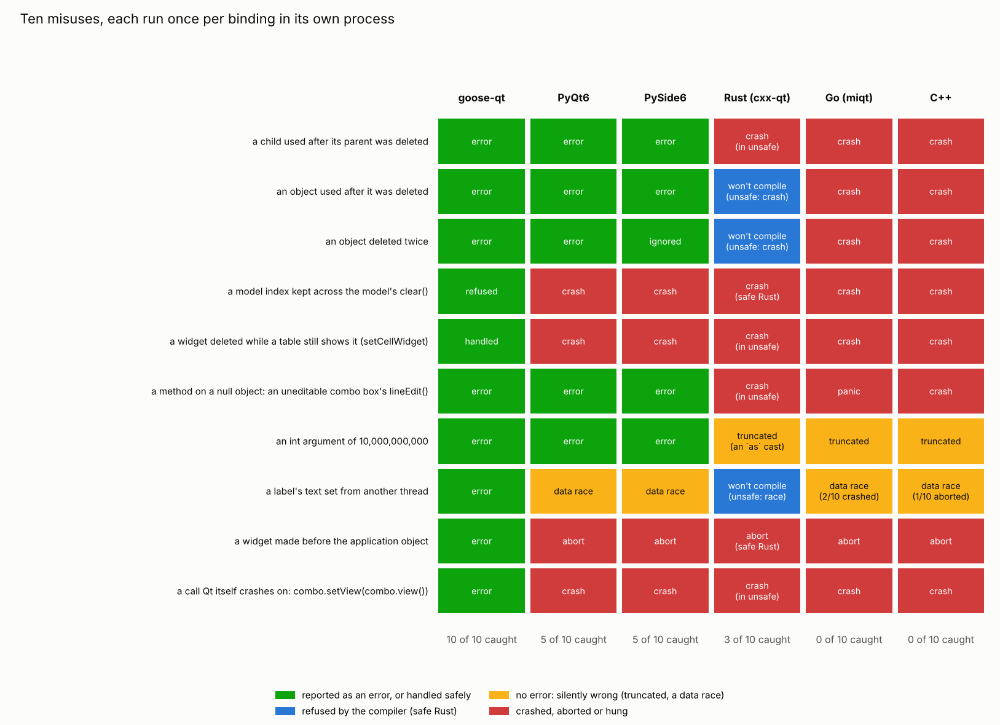

# How goose-qt compares

The same benchmark was written eight ways and run on one machine: C++ calling Qt directly,
qtc from C, goose-qt (native and JIT), PyQt6, PySide6, Go's
[miqt](https://github.com/mappu/miqt) and Rust's [cxx-qt](https://github.com/KDAB/cxx-qt).
All use Qt 6.12. The benchmark's source, and how to rerun it, are in
[bench/compare](../bench/compare); the raw numbers are in
[results.md](../bench/compare/results/results.md).

**In short:**
- **goose-qt is ahead of Go's miqt on every method call**, and 2–6× faster than PyQt6 and
  2–9× faster than PySide6. A plain call costs 20–67 ns, where C++ pays 1–26 ns.
- **Signals run inside the emission now, as in the other languages** (`qt::CONN_DIRECT`):
  157 ns from click to handler, against 185 for Go and 693 for PyQt6. The queued style, where
  a handler runs after the emission and may do anything, stays the default.
- **Making and destroying a `QObject` is level with Go** (135 ns against 141, within this
  machine's noise) and 1.6× faster than PyQt6. That pays for a handle, ownership tracking
  and the checks that turn "use after delete" into an error.
- **Small values are structs.** `qt::color(255, 0, 0).red()` takes 15 ns: 64× faster than
  PyQt6, 11× faster than Go, within 1.5× of Rust.
- **Rust's cxx-qt is the closest to C++.** It calls Qt through `cxx` bridges with nothing in
  between: 1–9× a direct C++ call, and a fraction of goose-qt's cost. It checks nothing at
  run time. Its misuse probes need `unsafe`, and all three crashed or silently truncated.
- **Where Qt calls back into your code** (a model written in the language), goose-qt is
  2.4× faster than Go and 4.2× faster than PyQt6, within 2.2× of C++.
- **Startup and memory are near C++.** A native goose-qt program starts in 24 ms, against
  17–21 ms for C++, Rust and Go and 70 ms for PyQt6, and peaks at 39 MiB, against 29–30 MiB
  for C++ and Rust, 43 MiB for Go and 49 MiB for PyQt6. The JIT starts in 0.43 s.
- **It catches all ten misuse probes** (use after delete, double delete, a stale model index,
  a widget deleted while Qt shows it, null, an integer too large, the wrong thread, no
  application yet, a call Qt crashes on). PyQt6 and PySide6 catch five, Rust three at
  compile time, Go and C++ none; the rest crash, abort or silently do the wrong thing.

Machine: two cores of a Xeon VM (2.1 GHz nominal; not the machine of the earlier runs, so
compare numbers within a table), 7 GB, Linux. Medians of five runs, each in its own
process; startup over 15 runs. Qt 6.12.0 everywhere: conda-forge's build for the compiled
programs, and Qt's own build inside the Python wheels. The C++ program ran on both, and the
two Qt builds are within a few percent of each other except for painting.

## Calls

| ns per call | C++ | Rust (cxx-qt) | qtc (C) | **goose-qt** | PyQt6 | PySide6 | Go (miqt) |
|---|---:|---:|---:|---:|---:|---:|---:|
| `label.setText("hello")` | 4.5 | 33 | 55 | **51** | 143 | 206 | 232 |
| `label.text()` | 1.7 | 15 | 60 | **67** | 132 | 213 | 173 |
| `slider.setValue(i)` | 26 | 31 | 51 | **51** | 161 | 218 | 75 |
| `slider.value()` | 0.7 | 3.4 | 16 | **20** | 111 | 176 | 55 |
| `setProperty("text", …)` | 49 | 71 | 134 | **139** | 496 | 452 | 492 |
| `button.click()` reaching a handler | 81 | 100 | 168 | **157** | 693 | 312 | 185 |
| the same, queued and polled | | | 207 | **159** | | | |
| `QColor(255, 0, 0).red()` | 1.7 | 10 | 18 | **15** | 966 | 464 | 162 |
| a `QObject` made and deleted | 41 | 43 | 156 | **135** | 220 | 1,945 | 141 |

goose-qt is the native build; the JIT adds 7–56% (more on the 15 ns color row). C++ is the
floor: a binding cannot beat a direct call. This machine is noisy: the five runs of a row
often spread by 20–70% (see the spread table in
[results.md](../bench/compare/results/results.md)), so differences under about 15% are
not meaningful.

Notes on the rows:
- **Calls.** goose-qt calls qtc's direct entry points: one C function per bound signature
  (`qtcm_setText__QString`), resolved once per class and then a jump to the thunk, with
  every check still made. Goose's typed wrappers compile to a direct call to them. Each
  entry point remembers the last class it was called on, and the "right thread,
  initialized" check is one comparison.
- **Rust.** cxx-qt declares each Qt method in a `cxx` bridge and calls it through a C++
  shim: nothing is looked up or checked at run time, so it pays only for the shim and string
  conversion. It is the fastest binding on every call row.
- **Signals.** C++, Python, Go and Rust run a function inside the emission; goose-qt does
  too with `qt::CONN_DIRECT`, which this row uses. The handler runs the way an
  override handler does: it may destroy the sender, which is deleted once Qt's call
  returns. The second row is the default style, where the emission is queued and the
  program polls it.
- **Value types.** goose-qt makes the color as a `qt::Color` struct with `QColor`'s own
  layout (`values.goose`, qtc's `qtc_inline.h`): no handle, a direct call into Qt, and still
  a check that the struct holds a valid color. Go keeps a raw pointer to a heap `QColor`,
  Rust a C++ value on its stack. Values without a struct form (`QFont`, `QImage`, ...) are
  handles in qtc's registry, as before.
- **Objects made and destroyed.** Every object gets a handle and its ownership is tracked:
  which objects hold it, whether Qt owns it, whether it is the internal part of another.
  That bookkeeping turns "use after delete" into an error instead of a crash (see below).
  qtc makes objects as a subclass whose destructor releases the handle (sip's technique)
  and deletes them at once. It skips the cleanups an object has nothing for: each handle's
  slot records whether the event layer or the ownership tracking keeps anything for its
  object, and most objects have neither; sanitizer builds check each skipped cleanup at
  run time. Of what is left over C++'s 41 ns,
  the two trips through the registry's lock (making and releasing the handle) are about
  10 ns; the rest is the handle bookkeeping, the ownership tracking and the checks.

## Whole tasks

| | C++ | Rust (cxx-qt) | qtc (C) | **goose-qt** | PyQt6 | PySide6 | Go (miqt) |
|---|---:|---:|---:|---:|---:|---:|---:|
| filter 1,000,000 rows of a model written in the language | 232 ms | 250 ms | 622 ms | **510 ms** | 2,144 ms | 2,476 ms | 1,202 ms |
| paint 100,000 lines into an image | 28 ms | 29 ms | 37 ms | **32 ms** | 54 ms | 50 ms | 34 ms |
| 2,000 buttons: create, show, paint, destroy | 65 ms | 54 ms | 44 ms | **45 ms** | 70 ms | 121 ms | 65 ms |
| startup to exit (a label shown and painted) | 17 ms | 21 ms | 22 ms | **24 ms** | 70 ms | 145 ms | 19 ms |
| peak memory of that program | 29 MiB | 30 MiB | 39 MiB | **39 MiB** | 49 MiB | 56 MiB | 43 MiB |

The model filter calls into the language once per row: Qt asks the model for each row's
text. goose-qt answers a million of those calls in 510 ms. That is 2.4× faster than Go,
4.2× faster than PyQt6 and 4.9× faster than PySide6. A model in C++ or Rust, which Qt calls
as a virtual function, takes 0.25 s.

Startup and memory used to be the cost of loading all of qtc at once: 25 Qt modules and the
tables of 13,600 methods. Now `libqtc` holds Qt Core, Gui and Widgets, and each
other module is a library of its own, loaded when the program first uses one of its classes.
A widgets program maps 4 Qt libraries instead of about 30.

The JIT compiles goose-qt's API at start. Nearly all of that time is the Goose compiler
checking every function of it, also those the program never calls. The API is split by Qt
module, and a program compiles only the modules it imports: this widgets program starts in
430 ms with 183 MiB, against 646 ms and 241 MiB with every module. A Goose
compiler that skipped the unused functions of imported packages when running a program
(they are checked by the package's own tests) would cut it further: with that change made
locally, the same program started in about 250 ms. Native builds do all of this ahead of
time.

## Safety and stability

Ten mistakes, each made once in each binding, every probe in a process of its own
([bench/compare/misuse](../bench/compare/misuse); output in
[misuse.txt](../bench/compare/results/misuse.txt)). They are mistakes real programs make:
using an object after Qt deleted it, keeping something across a reset, calling from the
wrong thread, passing a number too large, or a call Qt itself crashes on.

| | goose-qt | PyQt6 | PySide6 | Rust (cxx-qt) | Go (miqt) | C++ |
|---|---|---|---|---|---|---|
| a child used after its parent was deleted | **error** | error | error | crash (in `unsafe`) | crash | crash |
| an object used after it was deleted | **error** | error | error | won't compile; crash in `unsafe` | crash | crash |
| an object deleted twice | **error** | error | ignored | won't compile; crash in `unsafe` | crash | crash |
| a model index kept across the model's `clear()` | **refused** | crash | crash | crash, in safe Rust | crash | crash |
| a widget deleted while a table still shows it | **handled** | crash | crash | crash (in `unsafe`) | crash | crash |
| a method on a null object (`lineEdit()` of an uneditable combo box) | **error** | error | error | crash (in `unsafe`) | panic | crash |
| an `int` argument of 10,000,000,000 | **error** | error | error | truncated (an `as` cast) | truncated | truncated |
| a label's text set from another thread | **error** | data race | data race | won't compile; data race in `unsafe` | data race (2 of 10 runs crashed) | data race (1 of 10 aborted) |
| a widget made before the application object | **error** | abort | abort | abort, in safe Rust | abort | abort |
| a call Qt itself crashes on: `combo.setView(combo.view())` | **error** | crash | crash (in another run, a hang) | crash (in `unsafe`) | crash | crash |
| **caught** | **10 of 10** | 5 of 10 | 5 of 10 | 3 of 10, at compile time | 0 of 10 | 0 of 10 |

What each does:
- **goose-qt** reports eight as errors the program can check (`qt::last_error()`; or logs
  or aborts on them, by `qt::set_error_policy`), and handles two without one. The model index reads as
  invalid once its model is cleared, so `setData` returns false, as Qt's API says it does for
  an invalid index. The table lets go of the button before it is deleted, as `qtc_destroy`
  makes every holder do. Each object is a handle that goes stale when the object dies; the
  calling thread, every argument's range and type, and nearly 400 inputs known to crash Qt
  are checked on every call.
- **PyQt6 and PySide6** catch what Python itself can see: a deleted wrapper, `None`, an
  integer too large for C++. They do not track what Qt holds (the model's index, the
  table's cell widget), do not check threads (the GIL makes each call atomic, not the
  widget thread-safe), and pass Qt's own crashes through.
- **Rust** refuses three at compile time: a value cannot be used after it is dropped or be
  dropped twice, and cxx's C++ types cannot be sent to another thread. The others need
  `unsafe`, because cxx gives raw pointers for objects Qt owns (a parent's child, a cell
  widget, `lineEdit()`), and Rust trusts the program inside it. Two crash in safe Rust: the
  model index is a plain value Qt's model trusts, and Qt aborts on a widget made before the
  application. The 64-bit value needs an explicit `as i32`, which truncates. The compile
  errors were checked with cargo (E0382, E0277); the probes write the `unsafe` version to
  see what happens at run time.
- **Go (miqt)** checks nothing: a deleted object is a dangling pointer, `nil` panics, and
  wider integers are cut to fit.
- **C++** is the baseline: Qt trusts its caller.

Two probes vary between runs: setting a label from another thread is a data race wherever it
is not refused, and over ten runs each it aborted the C++ program once and crashed the Go
one twice (goose-qt reported the error all ten times). PySide6 hung on the combo box once in
earlier runs and crashed in this one.

### How the stability is tested

The probes show what happens to one mistake. qtc's tests are what keep the whole surface
from crashing ([qtc's TESTING.md](https://github.com/PXblaZe/qtc/blob/main/docs/TESTING.md)):

- **A method fuzzer** calls every bound method of every class with generated arguments
  (wrong types, nulls, extremes, objects in odd states, objects destroyed in between):
  90,000 to 170,000 calls a run, in a fixed order, by name, and in random orders, also under
  AddressSanitizer and UndefinedBehaviorSanitizer. Each crash it found became a check:
  that is where the nearly 400 refused inputs come from.
- **19 test suites** with 1,202 checks in `test_core` alone, run in release and sanitizer
  builds. Sanitizer builds also check at run time that the registry's shortcuts skip only
  work that is not there (`QTC_CROSSCHECK`).
- **Lifetime tests**: objects destroyed in random orders with their addresses reused at
  once, senders destroyed by their own handlers, handlers that nest.
- **goose-qt's own tests** call each of its 8,461 generated wrappers with a null receiver and
  check that every one reports the error (`test/t90_wrappers.goose`), and its
  [chaos sample](../samples/chaos/chaos.goose) runs a seeded storm of hostile calls (random
  widgets made, reparented and destroyed; 100 KB strings, invalid UTF-8, NaN, stale and
  forged handles, double frees, queue floods): a million operations each with seeds 1, 2 and
  3 end with nothing crashed and nothing leaked. See [Stability](stability.md).

What is still not covered is listed in qtc's [LIMITS.md](https://github.com/PXblaZe/qtc/blob/main/docs/LIMITS.md): for
example, Qt code that crashes with arguments no check can tell apart from good ones.

## How it got here

The first run of this comparison, early in development, had goose-qt behind PyQt6 on every
call. Each step since kept every check: caching what could be cached; a C function per
bound signature, called directly by goose-qt's wrappers, objects made as a subclass that
tells qtc when it dies, and a library per Qt module, loaded on first use; small values as
structs and a cheaper handle registry; cheaper object lifetimes; and for 1.0.0 cheaper
calls, signals that run inside the emission, and goose-qt's API split by Qt module.

The machine changed between runs, so this table gives each goose-qt number as a multiple
of PyQt6's speed in the same run (the runs are kept in `bench/compare/results/dev-*`):

| goose-qt, native, × PyQt6's speed | caching | direct calls | value structs | object lifetimes | 1.0.0 |
|---|---:|---:|---:|---:|---:|
| `label.setText("hello")` | 1.1× | 3.2× | 3.4× | 2.5× | 2.8× |
| `label.text()` | 1.0× | 2.1× | 2.3× | 1.9× | 2.0× |
| `slider.setValue(i)` | 1.1× | 3.1× | 2.9× | 2.6× | 3.1× |
| `slider.value()` | 1.2× | 5.5× | 5.3× | 4.7× | 5.5× |
| `setProperty("text", …)` | 1.8× | 3.6× | 3.6× | 3.1× | 3.6× |
| signal round trip | 2.2× | 3.3× | 3.4× | 2.8× | 4.4× (direct) |
| `QColor(255, 0, 0).red()` | 2.2× | 5.7× | 51× | 50× | 64× |
| a `QObject` made and deleted | 0.16× | 0.94× | 0.97× | 1.25× | 1.6× |
| million-row model filter | 3.7× | 3.7× | 3.9× | 3.8× | 4.2× |
| startup | 1.4× | 3.0× | 2.9× | 2.6× | 3.0× |
| peak memory (PyQt6's ÷ goose-qt's) | 0.74× | 1.25× | 1.25× | 1.24× | 1.24× |

qtc 1.0.0 passes its 19 test suites in release and AddressSanitizer + UndefinedBehaviorSanitizer
builds, the latter with the run-time cross-checks of the registry's shortcuts. The method
fuzzer ran on it under the sanitizers (fixed order, by name, object lifetimes, two random
orders) with no failures; one more random order timed out while other work loaded the
machine, and passed when run again alone. goose-qt's 11 tests, each in the JIT and native, and
12 examples pass against it.

## Caveats

- One machine and one Qt version. The ratios carry over better than the absolute numbers.
- Each row measures one operation in a tight loop. Real programs spend most of their time
  in Qt (layout, painting, text), where every binding costs the same.
- PyQt6 and PySide6 run on Qt's official build. The other programs run on conda-forge's
  build. The C++ row on both builds shows the difference: noise, except painting, where the
  official build is faster.
- miqt is version 0.15.0. Building its Qt 6 package took 21 minutes and more than 7 GB of
  memory (it was built with swap and the Go compiler's parallelism off).
- cxx-qt is version 0.10 with cxx-qt-lib's `qt_gui` feature. Widgets have no bindings in
  cxx-qt-lib, so the Rust program declares the `QWidget` classes it uses in its own `cxx`
  bridge (with a few lines of C++ for constructors), as a cxx-qt widgets program would.
