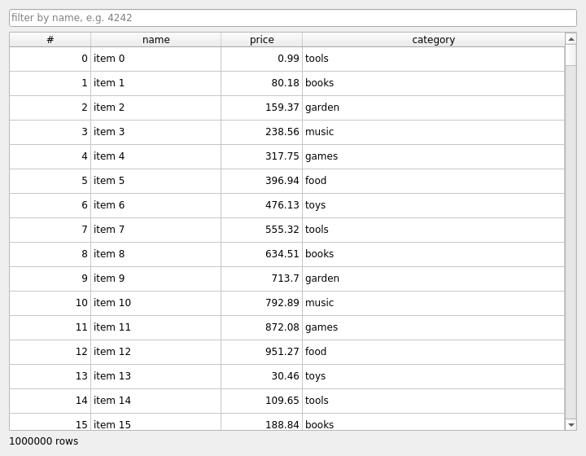
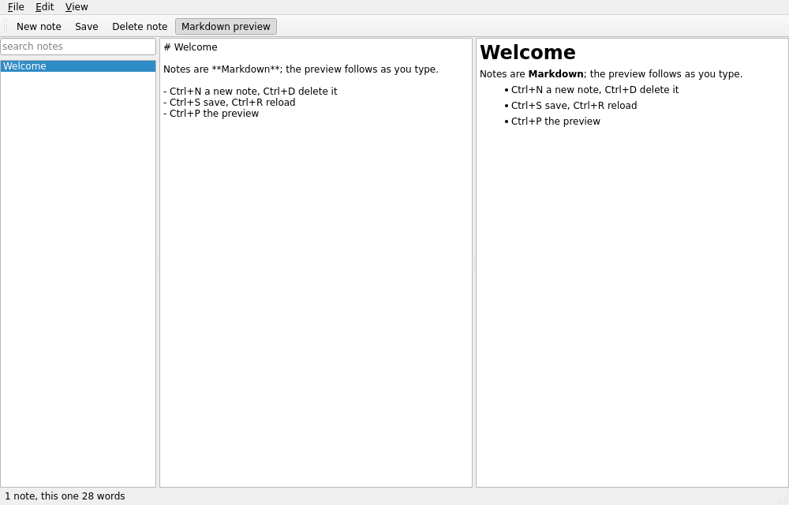
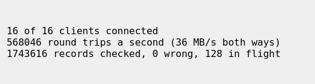
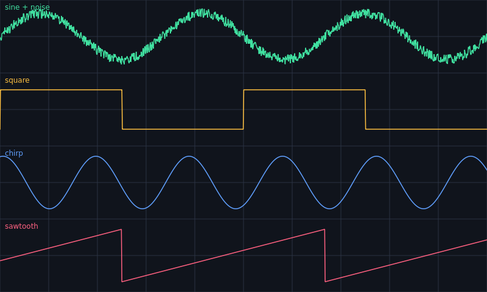
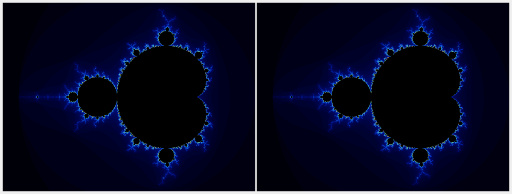

# Samples

Six programs that each push one part of goose-qt hard and then check what they did. The
[examples](../examples) show how to use a feature in a few lines; these are larger, closer to
real programs, and every one has a `--selftest` mode that runs without a display, prints what it
measured, and fails if any result is wrong or anything is left behind.

| Sample | Shows | JIT | Native |
|---|---|:---:|:---:|
| [million](million/million.goose) | a model written in Goose serving a million-row table, filtered as you type and sorted | ✓ | ✓ |
| [notes](notes/notes.goose) | a complete desktop app: menus, shortcuts, toolbar, live Markdown preview, JSON files | ✓ | ✓ |
| [loopback](loopback/loopback.goose) | Qt networking: an echo server, 16 clients and a 64 MB stream over TCP | ✓ | ✓ |
| [scope](scope/scope.goose) | four worker threads streaming samples to a widget painted in Goose |  | ✓ |
| [mandelbrot](mandelbrot/mandelbrot.goose) | the same image from four CPU threads and from a GPU compute shader, compared |  | ✓ |
| [chaos](chaos/chaos.goose) | a seeded storm of random and hostile calls that must neither crash nor leak | ✓ | ✓ |

Run one (the JIT runs no threads, so scope and mandelbrot are built):

```sh
cd samples/million
goose million.goose                       # the window
goose million.goose -- --selftest         # offscreen: measure and check
goose build million.goose -o million && ./million --selftest
```

or all of them, with the JIT and native, the way ctest does (`--quick` shortens chaos):

```sh
GOOSE=/path/to/goose QTC_LIB=/path/to/qtc/lib samples/run.sh
```

The numbers below come from one run of `samples/run.sh` on a small cloud machine: two cores of
a 2.1 GHz Xeon, 7 GB of memory, no GPU (Vulkan was Mesa's lavapipe, which runs shaders on the
CPU), Qt 6.12.0, a development build before 1.0.0, native builds unless marked. They show the order of things, not a
benchmark; your machine will differ.

## million: a million rows from Goose



A `QAbstractTableModel` subclassed in Goose (`qt::new_overridable` and `qt::override`) answers
`rowCount`, `columnCount`, `data` and `headerData` for 1,000,000 rows × 4 columns, held in Goose
arrays, and a `QTableView` shows it. Typing in the search box filters the rows in Goose: the
model keeps the list of rows that match, rebuilds it inside `beginResetModel` /
`endResetModel`, and the view then asks only for the cells it shows. Each character typed
narrows the list already shown instead of starting again.

| Self-test step | Native | JIT |
|---|---|---|
| model, view and first paint | 28 ms | 15 ms |
| 200 pages scrolled and painted | 437 ms (457 pages/s) | 437 ms |
| typing "4242" a key at a time, then deleting it | 3–26 ms a keystroke, 140 ms for all 8 | 4–160 ms a keystroke |
| sort of the 299 matches by price | 2 ms | 2 ms |

It checks the last row, that every keystroke left exactly the rows a brute-force count
expects, and that the sort put them in order.

Why not `QSortFilterProxyModel`? For thousands of rows it is the easy choice, but it asks the
model for every row on each change (a million calls into Goose), and it removes the rows that
no longer match one contiguous range at a time. Typing "4" keeps 468,559 rows spread over tens
of thousands of ranges, and that one keystroke took 14 s. A model that owns its data can
filter it far more cheaply itself.

The override handler formats each name into a fixed `u8[..24]` buffer rather than with
`str()`. That is quicker, and while the Goose compiler bug described in
[docs/subclassing.md](../docs/subclassing.md#handlers-that-allocate) is open, it also keeps
the handler off Goose's data stacks.

## notes: a whole app



A `QMainWindow` with File, Edit and View menus, keyboard shortcuts, a toolbar sharing the same
actions, and a status bar; a search box over a `QListWidget`; a `QPlainTextEdit` beside a
`QTextBrowser` that renders the note as Markdown as you type. The notes are a qtc list of maps,
so saving is `qt::json` written with `write_file_atomic` and loading is `qt::from_json`.

The self-test works the app through its own actions (`trigger()` on the same `QAction`s the
menus use): 2,000 notes made in 8 ms, one typed into (its list title, stored text and rendered
preview must agree), a search over all of them (54 of 54 expected shown, 6 ms), a save of 326 KB
of JSON in 5 ms, a reload in 17 ms that must give back exactly the same JSON, and a delete; then
no values may be left over.

## loopback: networking



A `QTcpServer` echoes whatever arrives; 16 `QTcpSocket` clients each keep 8 records of 32 bytes
in flight, and every record that comes back is checked byte by byte and in order. Then one client
streams 64 MB to a second server that checksums what arrives. All of it runs on the GUI thread's
event loop: Qt does the I/O, Goose handles each (coalesced) `readyRead`.

| Self-test step | Native | JIT |
|---|---|---|
| echo for 2 seconds | **780,000 round trips a second**, 0 wrong, 0 lost | 656,000 a second |
| 64 MB stream | 214 ms (298 MB/s), checksum equal | 229 ms (279 MB/s) |
| afterwards | 0 socket errors, 0 objects, 0 values left | the same |

## scope: threads into a painted widget



Four `thread_fn` workers generate a signal each (about 51,000 samples a second per channel) and
send them to the GUI thread with `qt::post`, eight 16-bit samples packed into one event. A
`QWidget` subclassed in Goose paints a grid and the last 1,024 samples of each channel in its
`paintEvent`. A future is the stop token: canceling it ends the workers.

Self-test, 3 seconds offscreen: **94 frames a second** with 387,000 points drawn a second,
202,000 samples a second arriving through 25,000 events a second, none dropped.

## mandelbrot: CPU threads and a GPU compute shader



The same 1024 × 768 image twice: by four Goose threads, each returning its band through a
future (`qt::add_bytes`), and by a GLSL compute shader built in Goose and run through Qt's RHI
on Vulkan, or OpenGL 4.3 when there is no Vulkan. The iteration counts go to Qt as a PPM built in
Goose, and the two images are compared pixel by pixel; double against single precision differ a
little along the edge of the set.

| Self-test step | Result |
|---|---|
| CPU, 4 Goose threads (on 2 cores) | 67 ms (11.7 Mpixel/s) |
| GPU, Vulkan on lavapipe | 51 ms with set-up and read-back (15.3 Mpixel/s); the shader baked in 45 ms |
| agreement | 99% of pixels equal; the test needs 97% within 3 iterations |

With no display and no `xvfb-run` there is no GPU context; the self-test then checks the CPU half
alone and says so. `--save` writes both images as PNG files.

## chaos: stability under abuse

No window: chaos is the stability sample. From a seed, it makes and destroys widgets of 25
classes, reparents them, calls 51 methods by name with hostile arguments (100 KB strings,
invalid UTF-8, extreme integers, NaN, stale and forged handles, null), reads and writes
properties, makes values of 17 types and frees some twice, parses bad JSON, connects and
disconnects signals, and floods the event queue past its limit. Every call must come back with a
result or an error code; nothing may crash, hang or leak.

| Run | Result |
|---|---|
| 300,000 operations, seed 1 | 7.5 s (40,000 a second): 165,961 calls succeeded, the rest refused with an error code, from `QTC_ERR_STALE_HANDLE` (87,673) to `QTC_ERR_AMBIGUOUS` (27); 388,470 events dropped past the queue limit; **0 objects, 0 values left over** |
| 1,000,000 operations, seeds 1, 2 and 3 | about 36,000 a second each, 0 left over |

```sh
./chaos --ops 1000000 --seed 42           # any seed: the same seed does the same things
```

What this sample checks in minutes, qtc's own fuzzer checks for hours, under AddressSanitizer
too; see [docs/stability.md](../docs/stability.md).
